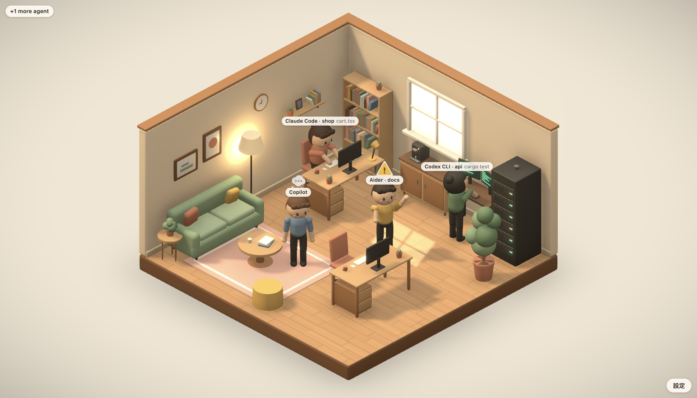

# AgentCubicle

把本機 AI Agent（Claude Code、Codex CLI、Aider、自製 agent…）的工作狀態，變成一間溫暖的等角視角小辦公室：
讀檔時翻書、寫程式時打字、跑指令時走到終端機、等你批准時舉手、完成時歡呼、出錯時抓頭。



- **只觀察、不控制**：不會批准、阻擋或修改任何 agent 的行為。
- **隱私**：不會讀取或轉送 prompt 與檔案內容；名牌上的路徑只顯示檔名。所有資料都留在本機。
- **多 agent**：每個 session 一個角色，兩張辦公桌、共用的終端機與沙發、等待區，再多就顯示「+N」。

## 安裝

到 Releases 下載對應平台的安裝檔（macOS `.dmg`、Windows `.exe`、Linux `.AppImage`），或依下方「打包」自行建置。

## 打包

### 事前準備（所有平台共通）

- Node.js 22、pnpm 12（`corepack enable` 會依 `package.json` 的 `packageManager` 自動取得）
- 第一次先安裝依賴（會順便下載 Electron）：

```sh
pnpm install
```

| 指令              | 產出（都在 `dist/`）                                                   |
| ----------------- | ---------------------------------------------------------------------- |
| `pnpm dist`       | 目前作業系統的預設安裝檔                                               |
| `pnpm dist:mac`   | `AgentCubicle-<版本>-<arch>.dmg`、`AgentCubicle-<版本>-<arch>-mac.zip` |
| `pnpm dist:win`   | `AgentCubicle Setup <版本>.exe`（NSIS 安裝程式）                       |
| `pnpm dist:linux` | `AgentCubicle-<版本>.AppImage`                                         |
| `pnpm dist:dir`   | 只產生未封裝的 App 資料夾（最快，用於測試）                            |

架構預設跟著執行 Node 的機器。要指定時在後面加 `--`：`pnpm dist:mac -- --arm64`、`--x64` 或 `--universal`（Intel + Apple Silicon 通用，檔案約兩倍大）。

打包後可跑 smoke test 確認 App 能啟動：`pnpm dist:dir && pnpm test:packaged`。

### macOS

```sh
# 沒有 Apple Developer ID 憑證時，關掉自動尋找簽章身分（產出未簽章版）
CSC_IDENTITY_AUTO_DISCOVERY=false pnpm dist:mac -- --arm64   # Apple Silicon（M1/M2/M3…）
CSC_IDENTITY_AUTO_DISCOVERY=false pnpm dist:mac -- --x64     # Intel Mac
```

> 若終端機跑在 Rosetta 底下（`uname -m` 顯示 `x86_64`，但機器是 Apple Silicon），請明確加 `--arm64`，否則會打包成 Intel 版。

安裝：

1. 打開 `dist/AgentCubicle-<版本>-arm64.dmg`，把 **AgentCubicle** 拖進「應用程式」資料夾。
   （也可以直接解壓 `-mac.zip`，或使用 `dist/mac-arm64/AgentCubicle.app`。）
2. 第一次開啟：在「應用程式」中對 AgentCubicle **按右鍵 →「打開」→「打開」**。
   未簽章版只有第一次需要這樣做。
3. 若從網路下載後出現「已損毀，無法打開」，是 Gatekeeper 的隔離標記，移除即可：

```sh
xattr -cr /Applications/AgentCubicle.app
```

正式簽章與公證（需要 Apple Developer Program）：

```sh
export CSC_LINK=/path/to/DeveloperID.p12  CSC_KEY_PASSWORD=...
export APPLE_API_KEY=/path/to/AuthKey_XXXX.p8  APPLE_API_KEY_ID=XXXX  APPLE_API_ISSUER=<issuer-uuid>
pnpm dist:mac -- -c.mac.notarize=true
```

### Windows

在 Windows（PowerShell）上：

```powershell
pnpm install
pnpm dist:win
```

安裝：執行 `dist\AgentCubicle Setup <版本>.exe`，可選擇安裝路徑；完成後從開始選單開啟。
未簽章版會出現 SmartScreen「Windows 已保護您的電腦」，按「**其他資訊 → 仍要執行**」。
移除：「設定 → 應用程式」找到 AgentCubicle 解除安裝。

簽章：設定 `CSC_LINK`（或 `WIN_CSC_LINK`）指向 `.pfx` 憑證、`CSC_KEY_PASSWORD` 為密碼後再打包。

### Linux

```sh
pnpm install
pnpm dist:linux                  # x64
pnpm dist:linux -- --arm64       # ARM64
```

執行：

```sh
chmod +x AgentCubicle-<版本>.AppImage
./AgentCubicle-<版本>.AppImage
```

AppImage 需要 FUSE 2。Ubuntu 22.04 以後若出現 `dlopen(): error loading libfuse.so.2`，安裝 `libfuse2`（24.04 為 `libfuse2t64`）。

### 跨平台打包

在 macOS 上可以直接產出 Windows（`pnpm dist:win`）與 Linux（`pnpm dist:linux`）安裝檔，未簽章時不需要 Wine。
但交叉產出的安裝檔無法在本機實測，Windows 程式碼簽章也需在 Windows 或 CI 上進行，所以正式發佈建議交給 CI。

### 用 GitHub Actions 一次打包三個平台

推送 `v` 開頭的 tag，`.github/workflows/release.yml` 會在 macOS / Windows / Linux runner 上各自打包，並上傳到一個 draft Release：

```sh
# 先把 package.json 的 version 改成 0.1.0
git tag v0.1.0
git push origin v0.1.0
```

在 repo 的 Settings → Secrets 設定 `CSC_LINK`、`CSC_KEY_PASSWORD`、`APPLE_API_KEY`、`APPLE_API_KEY_ID`、`APPLE_API_ISSUER` 時會自動簽章與公證；沒有設定則產出未簽章版。

App 圖示來自 `build/icon.png`（1024×1024），electron-builder 會自動轉成 `.icns` / `.ico`。

## 換角色

「設定」→「**角色**」可以切換辦公室裡的角色，馬上生效，選擇會被記住：

| 角色           | 說明                                   |
| -------------- | -------------------------------------- |
| 上班族         | 原本的 Q 版小人（預設）                |
| You never know | 黃色小鴨                               |
| Kuro           | 黑色兔耳                               |
| Naughty        | 紅色小熊                               |
| Nicky          | 藍色貓咪                               |
| Belle          | 粉紅長毛                               |
| John           | 奶油色、黑色垂耳的狗                   |
| 自動           | 每個 agent 分配不同角色（依 agent id） |

換角色只改外觀：狀態、動作、座位完全相同。六隻 mojojojo 角色是依產品圖量測輪廓後，用程式（Three.js）生成的 3D 模型，沒有內嵌任何圖片素材，詳見 [assets/LICENSES.md](assets/LICENSES.md)。

## 場景與視角

「設定」→「**場景**」可以換整個辦公室的風格，家具位置與角色動線不變，只換佈置、顏色與燈光：

| 場景       | 說明                                                               |
| ---------- | ------------------------------------------------------------------ |
| 溫暖辦公室 | 原本的暖色小辦公室（預設）                                         |
| 駭客基地   | 深色霓虹：發光網格地板、牆上的程式碼雨與 ROOT 霓虹招牌、綠色終端機 |

駭客基地裡所有角色會戴上霓虹眼鏡與耳機麥克風，上班族換成黑色連帽衫。

「**視角**」預設是固定等角；改成「自由旋轉」後，左鍵拖曳轉動、滾輪縮放，按「重設視角」或切回固定等角就回到預設畫面。

角色不會陷進家具：`pnpm test` 會把每個角色擺到沙發、椅子、終端機等所有位置與動作，逐頂點檢查有沒有穿進家具（`src/renderer/src/scene/colliders.test.ts`），並檢查走路動線不撞到家具（`walking.test.ts`）。

## 連接 Claude Code

1. 開啟 AgentCubicle，點右下角「**設定**」。
2. 在「Claude Code」區按「**連接 Claude Code…**」。
3. 檢查畫面上 `~/.claude/settings.json` 的差異（只會新增標有 `agentcubicle-hook` 的觀察用 hooks），按「**確認套用**」。
   原檔會先備份為 `settings.json.agentcubicle-backup-<時間>`。
4. 之後開的 Claude Code session 都會出現在辦公室裡。要移除：同一個地方按「中斷連接…」。

沒有安裝 hooks 時，AgentCubicle 也會讀取 `~/.claude/projects/` 下的紀錄檔推估活動（較不精準，沒有「等待批准」）。

其他 agent 請見 [docs/INTEGRATIONS.md](docs/INTEGRATIONS.md)（Webhook、curl / Python 範例）。

## 角色在做什麼？

| 狀態         | 角色           | 提示                 |
| ------------ | -------------- | -------------------- |
| 閒置         | 坐沙發喝咖啡   |                      |
| 思考（推定） | 托腮           | 淡色思考泡泡         |
| 讀檔 / 搜尋  | 在桌前看書     |                      |
| 寫檔         | 在桌前快速打字 | 螢幕亮起             |
| 執行指令     | 站在終端機前   | 程式碼捲動           |
| 等待批准     | 舉手揮動       | ⚠                    |
| 完成         | 歡呼           | ✓                    |
| 出錯         | 抓頭           | 紅色 ！、螢幕變紅    |
| 很久沒有消息 | 停在原地       | ？（不會假裝已完成） |

## 設定

「設定」面板可以調整畫質（高 / 平衡 / 省電）與視窗置頂。視窗最小化或被遮住時會自動暫停繪製；省電模式限制在 30 FPS。

## 疑難排解

| 狀況                            | 處理                                                                                                |
| ------------------------------- | --------------------------------------------------------------------------------------------------- |
| 「Port 9876 is already in use」 | 關掉另一個 AgentCubicle，或用環境變數 `CUBICLE_PORT` 指定其他埠（hooks 會自動跟著新埠，不需重裝）。 |
| 連接後角色沒反應                | 在設定面板確認「最近事件」時間；若一直沒有事件，重新開一個 Claude Code session 再試。               |
| 想完全移除                      | 先在設定面板「中斷連接」，再刪除 App 與 `~/.agentcubicle`。                                         |
| settings.json 格式錯誤          | AgentCubicle 不會覆寫無法解析的檔案；修正後再試。                                                   |

## 開發

```sh
pnpm dev                                   # 開發模式
CUBICLE_DIAGNOSTICS=1 pnpm dev             # 顯示診斷與 Dev 面板（F3）
pnpm sim list / pnpm sim post normal-task  # 模擬器
pnpm test && pnpm test:e2e                 # 單元 + 端到端測試
pnpm screenshots                           # 固定視角截圖基準
pnpm dist:dir && pnpm test:packaged        # 打包版 smoke test
pnpm build && SOAK_MINUTES=30 pnpm soak    # 長時間穩定性測試
pnpm build && pnpm verify:claude           # 用真實 Claude Code 驗證（暫存 settings，少量額度）
pnpm build && pnpm icon                    # 從 3D 場景重新產生 App 圖示
pnpm build && pnpm exec tsx tools/preview/capture.ts out/shots 640x720 duck,posture=rest   # 單一角色預覽（?preview=）
pnpm build && pnpm exec tsx tools/preview/scene.ts out/shots duck WRITE IDLE              # 在辦公室裡看某個角色
```

架構與規格：[docs/SPEC.md](docs/SPEC.md)；進度與量測：[docs/PROGRESS.md](docs/PROGRESS.md)。
